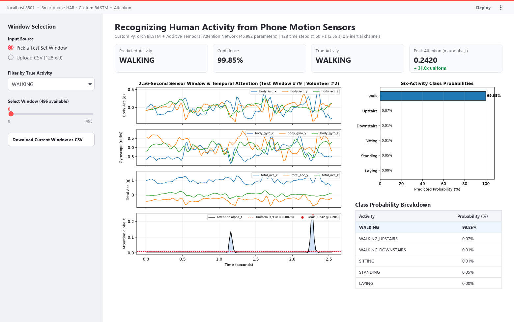
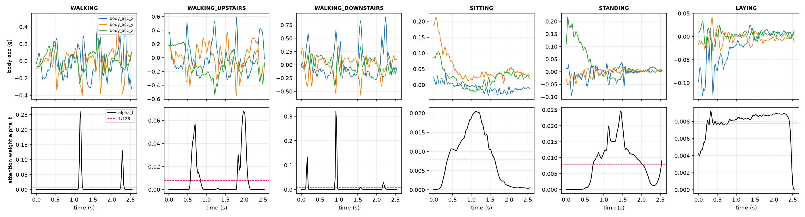
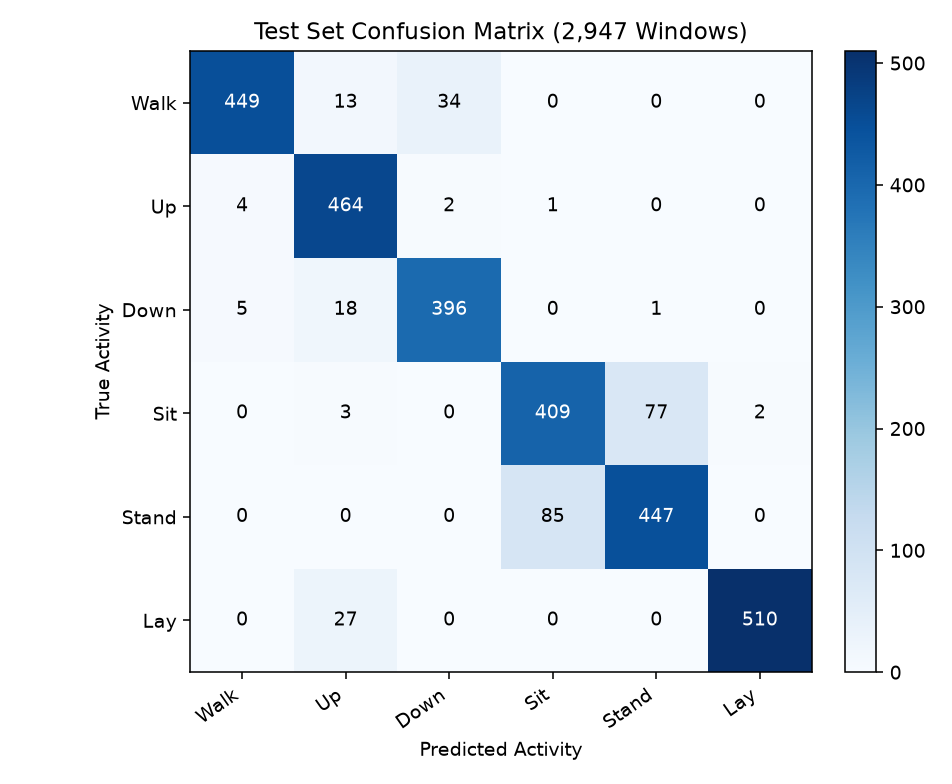
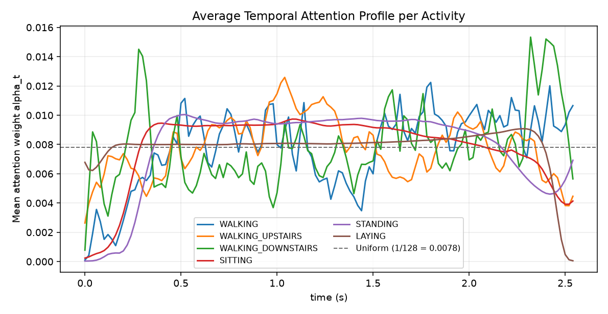

# Smartphone Human Activity Recognition via Custom BiLSTM & Temporal Attention

**Authors:** Abdul Rehman & Rizwana Mubarak

End-to-end **Human Activity Recognition (HAR)** from raw 3-axial smartphone accelerometer and gyroscope streams (`128 time steps @ 50 Hz = 2.56 s`, `9 sensor channels`), built **from first principles in PyTorch** without off-the-shelf `nn.LSTM` or `nn.MultiheadAttention` wrappers.

---

## Highlights

- **From-Scratch Recurrent & Attention Primitives**: Custom `RNNCell`, `LSTMCell` (explicitly unrolled from stacked input, forget, candidate, and output gate equations), bidirectional `BiLSTM`, and additive temporal `Attention` pooling (`46,982` trainable parameters).
- **Zero-Leakage Subject Split**: Strict volunteer-disjoint partitioning across 30 subjects (`17` train / `4` validation / `9` unseen test subjects) so 50%-overlapping time windows never leak across splits, with per-channel standardisation fitted solely on training windows.
- **Interpretable Temporal Attention**: Directly visualises *which instants* of a 2.56-second window drive activity predictions — revealing `18x–32x` attention spikes on heel-strike/push-off phases during locomotion vs. near-uniform pooling on static postures.
- **Interactive Streamlit Web Dashboard**: Inspect any held-out test window or upload custom `128 x 9` inertial CSV recordings with real-time waveform plots, 6-class probability bars, and temporal attention curves.

---

## Architecture

```text
Input Window: (B, 128, 9)  [50 Hz x 2.56 s across 9 inertial channels]
       │
       ├──► Forward LSTM  (D=9 ──► H=64, unrolled t = 1..128)
       │                                                       ├──► Concat ──► (B, 128, 128)
       └──► Backward LSTM (D=9 ──► H=64, unrolled t = 128..1)
                                                                       │
                        Additive Temporal Attention (Wa: 64x128, ba: 64, v: 64)
                         e_t = v^T tanh(Wa h_t + ba),  alpha = softmax(e)
                                                                       │
                                  Context Vector c = sum_t alpha_t h_t : (B, 128)
                                                                       │
                                              Linear Classifier (128 ──► 6)
                                                                       │
                                     Output: 6 Activity Logits + Attention alpha_t
```

### Nine Raw Inertial Channels (UCI HAR Dataset)
| Channel Group | Signals | Physical Meaning | Unit |
|---|---|---|---|
| Body Acceleration | `body_acc_x`, `body_acc_y`, `body_acc_z` | Linear body motion (gravity filtered out) | $g$ |
| Gyroscope | `body_gyro_x`, `body_gyro_y`, `body_gyro_z` | Triaxial angular velocity | $\text{rad/s}$ |
| Total Acceleration | `total_acc_x`, `total_acc_y`, `total_acc_z` | Raw triaxial acceleration including $1g$ gravity | $g$ |

---

## Project Layout

```text
├── scripts/
│   └── download_data.py     # Automated downloader & extractor for raw UCI HAR signals
├── src/
│   ├── load_data.py         # Raw 9-channel inertial window loader
│   ├── plot_windows.py      # Multi-channel waveform visualiser across all 6 activities
│   ├── prepare.py           # Subject-wise split & training-only channel standardisation
│   ├── layers.py            # Custom RNNCell, LSTMCell, LSTM, BiLSTM, and Attention modules
│   ├── model.py             # HARNet definition & analytical parameter verification (46,982)
│   ├── train.py             # Mini-batch Adam trainer with L2 gradient clipping (norm 1.0)
│   ├── metrics.py           # From-scratch accuracy, confusion_matrix, and per_class_accuracy
│   └── test_model.py        # Held-out test evaluation, confusion heatmap & attention analysis
├── app/
│   └── app.py               # Interactive Streamlit web dashboard (test explorer + CSV upload)
├── results/                 # Pretrained checkpoint (best_model.pt), plots, tables.md, analysis.md
└── requirements.txt
```

---

## Quickstart

### 1. Install Dependencies
```bash
pip install -r requirements.txt
```

### 2. Download & Extract Raw UCI HAR Signals
*(Note: The UCI archive contains the raw `Inertial Signals/` folders required here; `data/` is git-ignored.)*
```bash
python scripts/download_data.py
```
*(Or manually unzip the [UCI HAR Dataset](https://archive.ics.uci.edu/dataset/240/human+activity+recognition+using+smartphones) and its inner `UCI HAR Dataset.zip` into `data/`.)*

### 3. Inspect Data, Verify Architecture, Train & Evaluate
```bash
python src/load_data.py
python src/plot_windows.py
python src/prepare.py
python src/model.py
python src/train.py
python src/test_model.py
```

### 4. Run the Interactive Web Application
```bash
streamlit run app/app.py
```

---

## Interactive Web Interface

Pick any test window or upload a `128 rows x 9 columns` CSV sensor recording to inspect raw triaxial signals, 6-class softmax probabilities, and temporal attention weights $\alpha_t$ side-by-side:



---

## Results & Temporal Attention Visualisations

Full quantitative benchmarks are documented in [`results/tables.md`](results/tables.md) and [`results/analysis.md`](results/analysis.md).

### Temporal Attention Under Raw Body Acceleration


### Confusion Matrix & Average Attention Profiles
| Held-Out Test Confusion Matrix | Mean Attention Profile per Activity |
|---|---|
|  |  |

---

## License

Released under the [MIT License](LICENSE).
